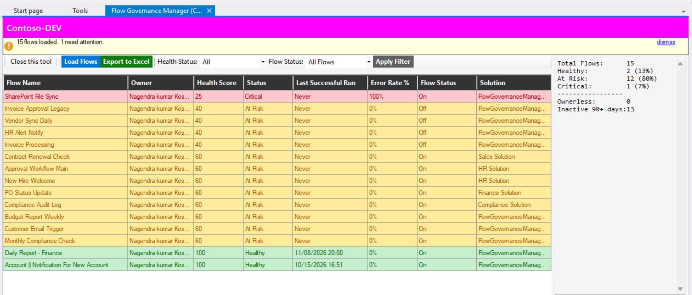
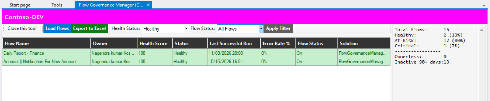
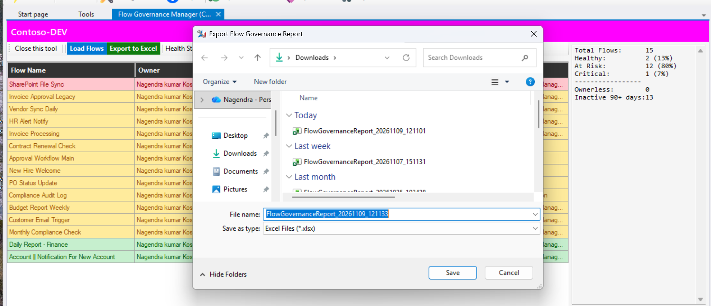

# Flow Governance Manager for XrmToolBox

A free XrmToolBox plugin that gives you a health score for every Power Automate flow in your Dataverse environment — so you can find and fix problems before they become incidents.



## Why I built this

In most Dataverse environments, flows pile up over time. Owners leave the organization. Flows get turned off and forgotten. Some fail silently for months. By the time someone notices, a business process is already broken.

I wanted a single view that tells me which flows are healthy, which ones need attention, and why — without clicking through each flow individually in the Power Platform admin center.

## What it does

Each flow gets a health score from 0 to 100. The score drops when things are wrong — the owner left, the flow has never run, the error rate is high, the flow is turned off. You can filter by health status or flow status, and export the full report to Excel.

The scoring works like this:

| Risk Factor | Points Deducted |
|---|---|
| Owner is disabled or left the org | 40 |
| Flow has never successfully run | 40 |
| Error rate above 50% | 35 |
| Flow is turned off | 20 |
| Error rate above 20% | 20 |
| No successful run in 90+ days | 20 |
| No successful run in 30-90 days | 10 |

Scores 70 and above are Healthy. 40 to 69 are At Risk. Below 40 are Critical.

## Screenshots

### All flows loaded


### Filtered by health status


### Export to Excel


## Installation

Search for "Flow Governance Manager" in the XrmToolBox Plugin Store and install from there. Or download the latest release and drop the DLL into your XrmToolBox Plugins folder manually.

## How to use it

1. Connect XrmToolBox to your environment
2. Open Flow Governance Manager
3. Click Load Flows
4. Review the grid — red rows need attention first
5. Use the dropdowns to filter by health or flow status
6. Export to Excel if you need to share the report

## Requirements

- XrmToolBox 1.2023.x or later
- .NET Framework 4.6.2
- Read access to the workflow, systemuser, flowrun, and solution tables in Dataverse

The plugin is read-only. It does not write anything to Dataverse.

## Building from source

```bash
git clone https://github.com/knkumar-1215/XrmToolBox-FlowGovernanceManager.git
```

Open the solution in Visual Studio 2022 and build. NuGet will restore XrmToolBox, Microsoft.CrmSdk.CoreAssemblies, and MiniExcel automatically.

## What is coming next

V2:
- Bulk ownership reassignment
- Environment comparison across DEV, UAT, and PROD
- Deprecated connector detection
- Configurable scoring thresholds
- Flow dependency map

V3:
- AI-assisted flow analysis
- Natural language search
- Predictive health alerts
- Automated governance reports
- Governance policy engine

## Author

Nagendra kumar Kosaraju — Senior Dataverse and Power Platform Developer

[GitHub](https://github.com/knkumar-1215)

## License

MIT
